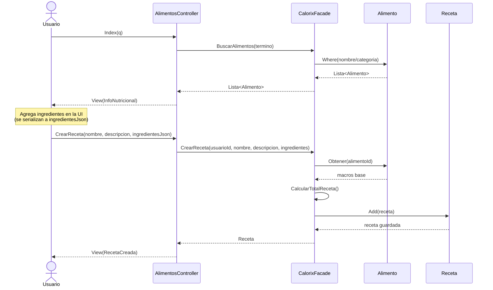
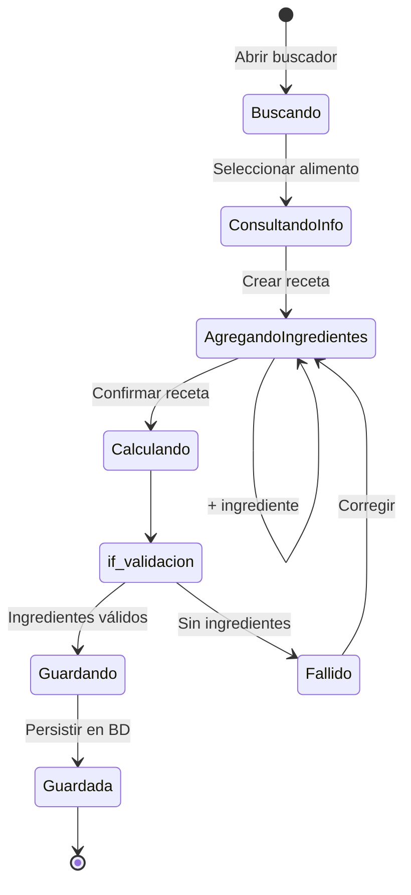
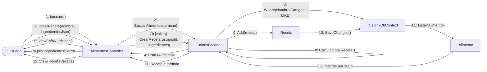

# CU1 — Gestión de Alimentos

| Campo | Valor |
| --- | --- |
| **Actor principal** | Usuario |
| **Alcance** | Aplicación de nutrición (Calorix) |
| **Nivel** | Usuario (Nivel 1) |
| **Precondición** | Usuario autenticado |
| **Postcondición** | Receta personalizada guardada en biblioteca del usuario |

## Flujo principal

1. El usuario accede al buscador de alimentos.
2. El sistema muestra la información nutricional (calorías, macros) del alimento seleccionado.
3. El usuario crea una receta personalizada.
4. El usuario agrega múltiples ingredientes y cantidades.
5. El sistema calcula el valor total de la receta.
6. El sistema guarda la receta en la biblioteca personal.

## Diagrama de secuencia

## Diagrama de estados

## Diagrama de colaboración

