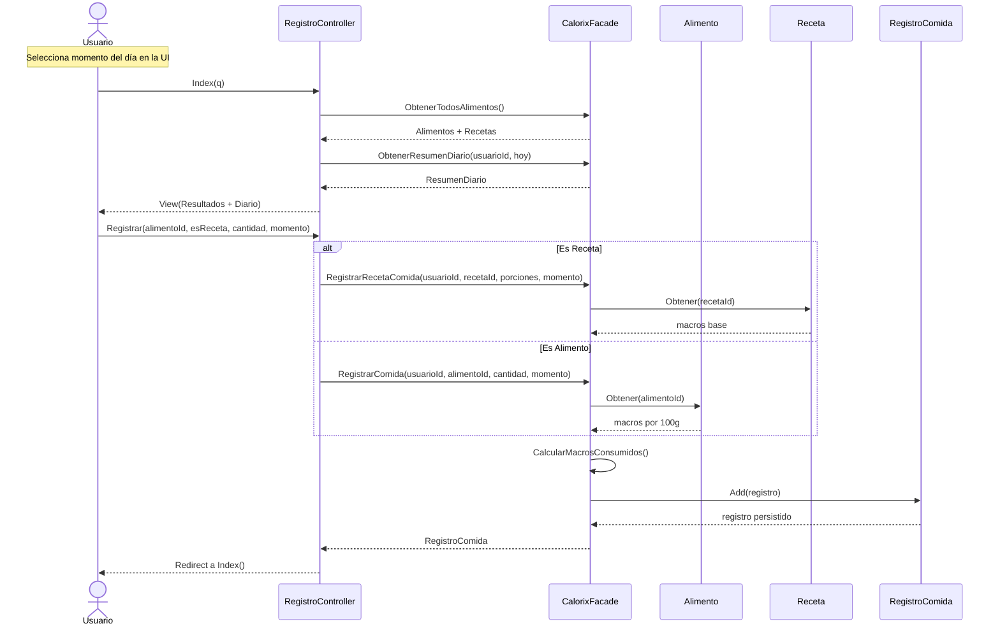
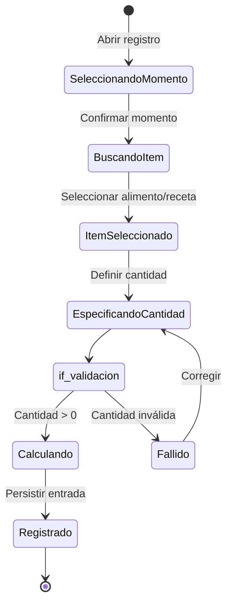
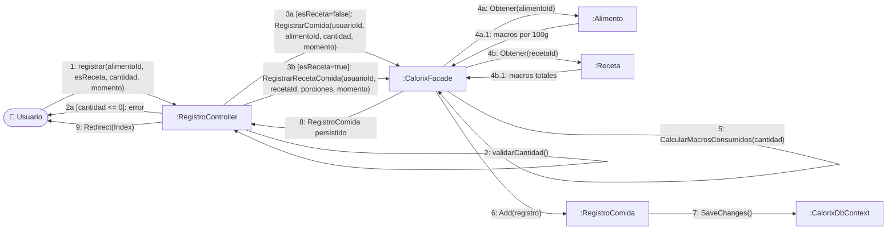

# CU2 — Registro de Comidas

| Campo | Valor |
| --- | --- |
| **Actor principal** | Usuario |
| **Alcance** | Aplicación de nutrición (Calorix) |
| **Nivel** | Usuario (Nivel 1) |
| **Precondición** | Usuario autenticado |
| **Postcondición** | Comida registrada en el diario diario con macros calculados |

## Flujo principal

1. El usuario selecciona el momento del día (Desayuno, Comida, Cena o Snack).
2. El usuario busca y selecciona un alimento o una receta guardada.
3. El usuario especifica la cantidad consumida (gramos o porciones).
4. El sistema registra la entrada en el diario del día actual.
5. El usuario consulta el historial diario para verificar el total.

## Diagrama de secuencia

## Diagrama de estados

## Diagrama de colaboración

