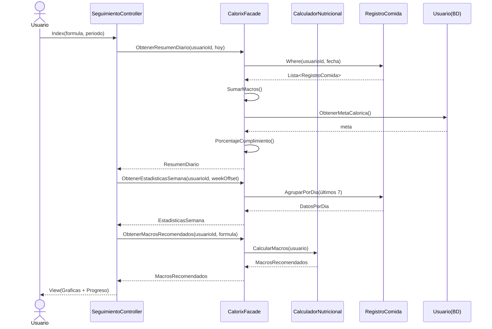
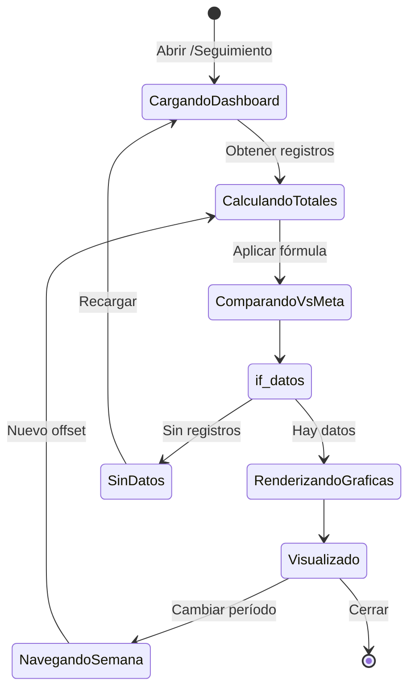
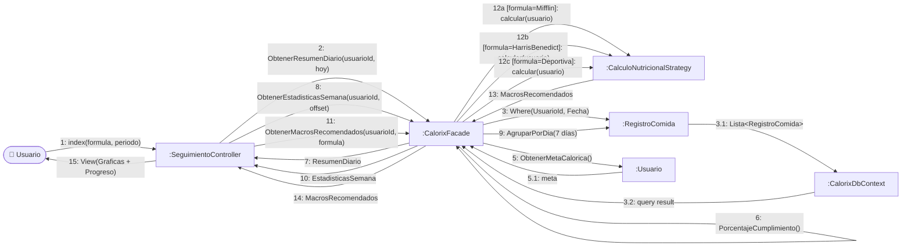

# CU3 — Seguimiento Nutricional

| Campo | Valor |
| --- | --- |
| **Actor principal** | Usuario |
| **Alcance** | Aplicación de nutrición (Calorix) |
| **Nivel** | Usuario (Nivel 1) |
| **Precondición** | Usuario autenticado con registros de comidas |
| **Postcondición** | El usuario visualiza su progreso vs. metas con gráficas |

## Flujo principal

1. El usuario ingresa al dashboard de estadísticas.
2. El sistema calcula la suma total de calorías y macronutrientes consumidos.
3. El sistema compara los datos actuales con las metas diarias.
4. El usuario visualiza gráficas de progreso semanal o mensual.

## Diagrama de secuencia

## Diagrama de estados

## Diagrama de colaboración

