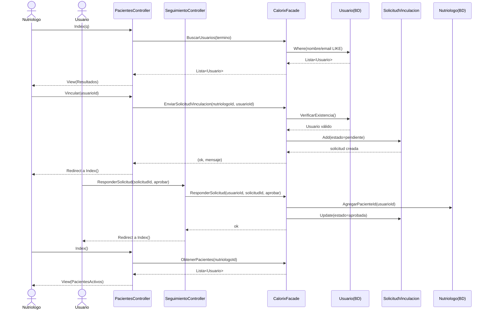
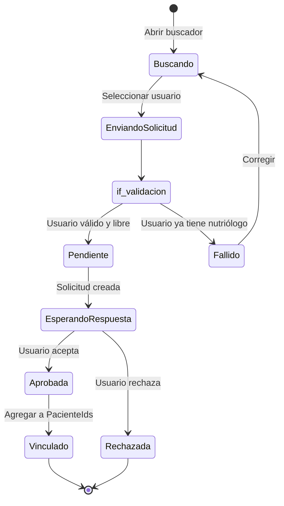
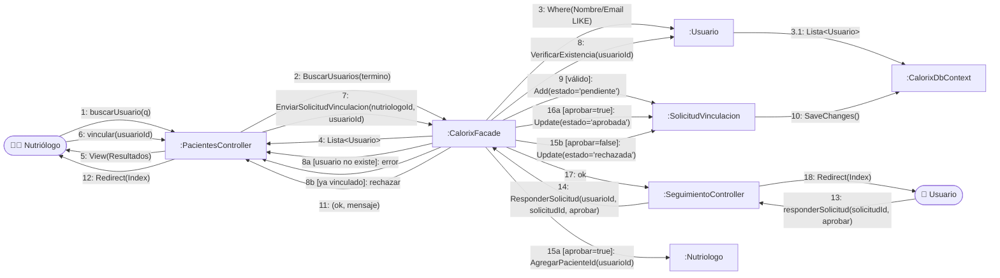

# CU4 — Gestión de Pacientes

| Campo | Valor |
| --- | --- |
| **Actor principal** | Nutriólogo |
| **Alcance** | Aplicación de nutrición (Calorix) |
| **Nivel** | Usuario (Nivel 1) |
| **Precondición** | Nutriólogo autenticado y validado |
| **Postcondición** | Paciente vinculado al nutriólogo (tras aprobación del usuario) |

## Flujo principal

1. El nutriólogo busca un usuario por nombre o correo.
2. El nutriólogo envía una solicitud de vinculación.
3. El sistema valida la existencia del usuario y registra la solicitud.
4. El usuario aprueba la solicitud y queda vinculado al nutriólogo.
5. El nutriólogo organiza su lista de pacientes activos.

## Diagrama de secuencia

## Diagrama de estados

## Diagrama de colaboración

