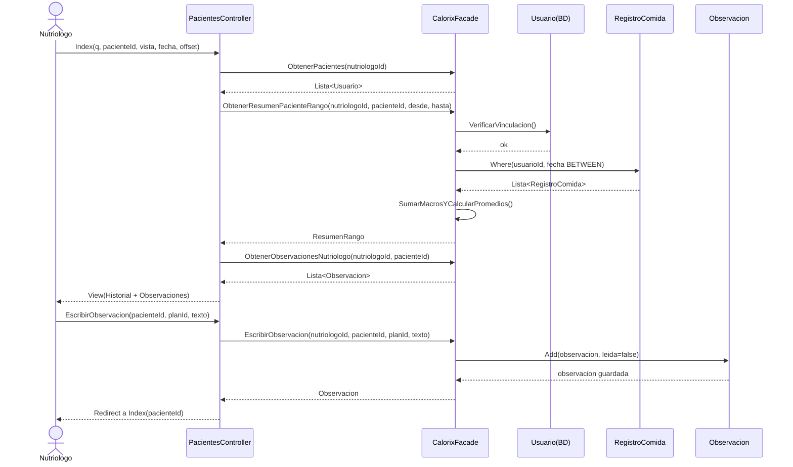
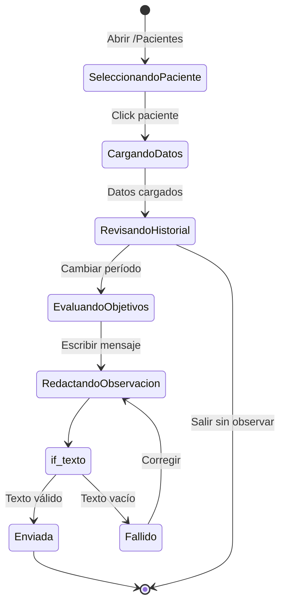
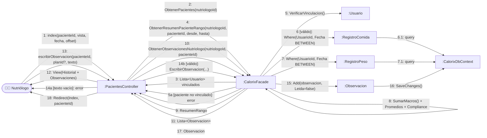

# CU5 — Sistema de Seguimiento Profesional

| Campo | Valor |
| --- | --- |
| **Actor principal** | Nutriólogo |
| **Actores secundarios** | Paciente (indirecto, como dueño de los datos) |
| **Alcance** | Aplicación de nutrición (Calorix) |
| **Nivel** | Usuario (Nivel 1) |
| **Precondición** | Nutriólogo con al menos un paciente vinculado |
| **Postcondición** | Nutriólogo registra observación visible para el paciente |

## Flujo principal

1. El nutriólogo selecciona un paciente de su lista asignada.
2. El sistema despliega la información personal y el historial de comidas.
3. El nutriólogo revisa el consumo nutricional diario y semanal.
4. El nutriólogo monitorea el cumplimiento de objetivos.
5. El nutriólogo escribe una observación sobre el progreso.

## Diagrama de secuencia

## Diagrama de estados

## Diagrama de colaboración

