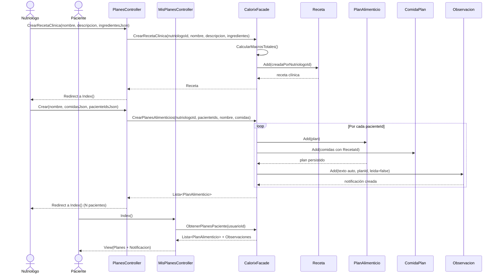
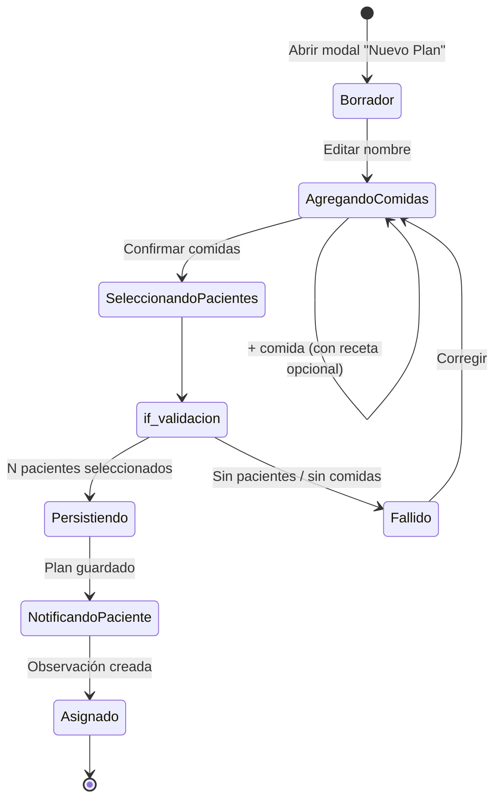
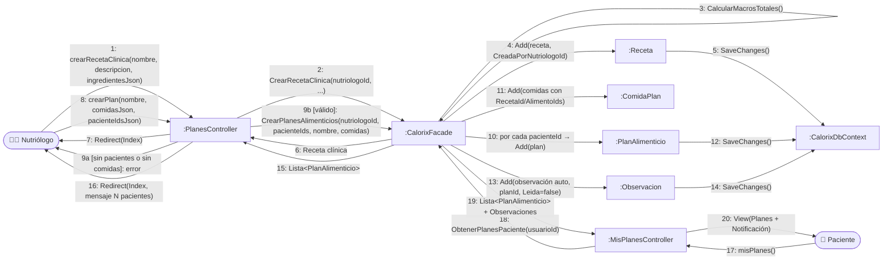

# CU6 — Planes Alimenticios

| Campo | Valor |
| --- | --- |
| **Actor principal** | Nutriólogo |
| **Actores secundarios** | Paciente (recibe notificación) |
| **Alcance** | Aplicación de nutrición (Calorix) |
| **Nivel** | Usuario (Nivel 1) |
| **Precondición** | Nutriólogo con uno o más pacientes vinculados |
| **Postcondición** | Plan asignado a uno o varios pacientes; observación de notificación creada automáticamente |

## Flujo principal

1. El nutriólogo crea o edita recetas clínicas según necesidades del paciente.
2. El nutriólogo diseña un plan de alimentación estructurado.
3. El nutriólogo asigna el plan a uno o varios pacientes.
4. El sistema notifica al paciente con una observación automática.

## Diagrama de secuencia

## Diagrama de estados

## Diagrama de colaboración

