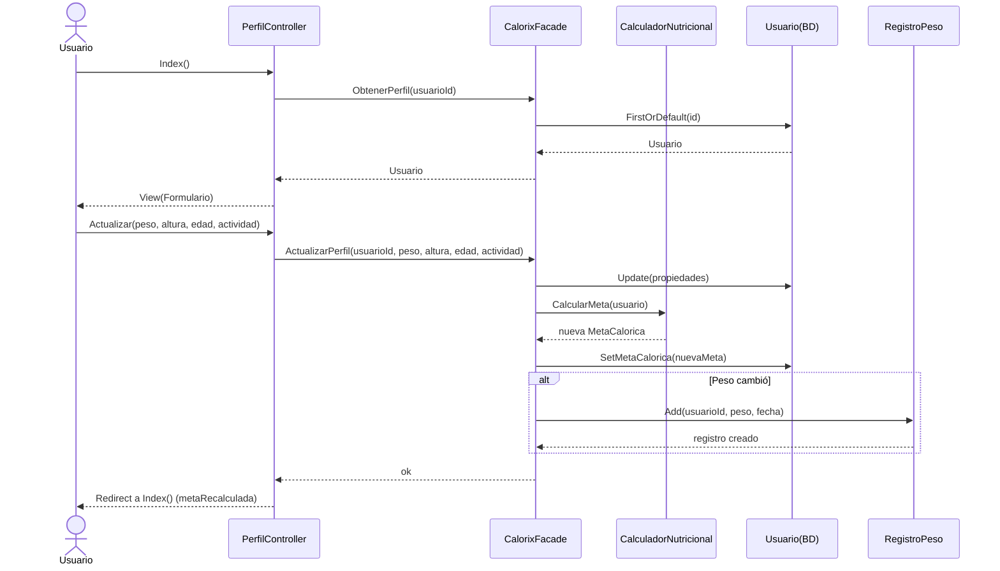
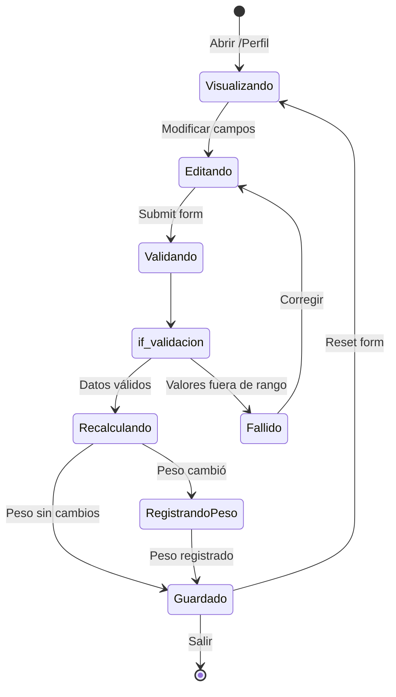
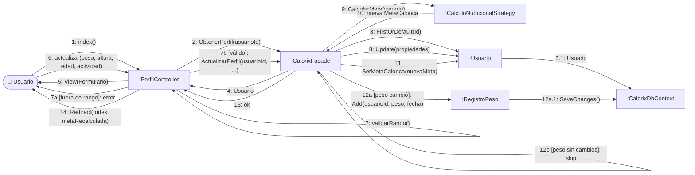

# CU7 — Perfil / Información Personal

| Campo | Valor |
| --- | --- |
| **Actor principal** | Usuario |
| **Alcance** | Aplicación de nutrición (Calorix) |
| **Nivel** | Usuario (Nivel 1) |
| **Precondición** | Usuario autenticado |
| **Postcondición** | Datos antropométricos actualizados; meta calórica recalculada; nuevo registro de peso si cambió |

## Flujo principal

1. El usuario accede a la configuración de su perfil.
2. El usuario actualiza sus medidas antropométricas (peso, altura).
3. El usuario modifica datos básicos como edad y nivel de actividad física.
4. El sistema recalcula los requerimientos calóricos basados en la nueva información.

## Diagrama de secuencia

## Diagrama de estados

## Diagrama de colaboración

