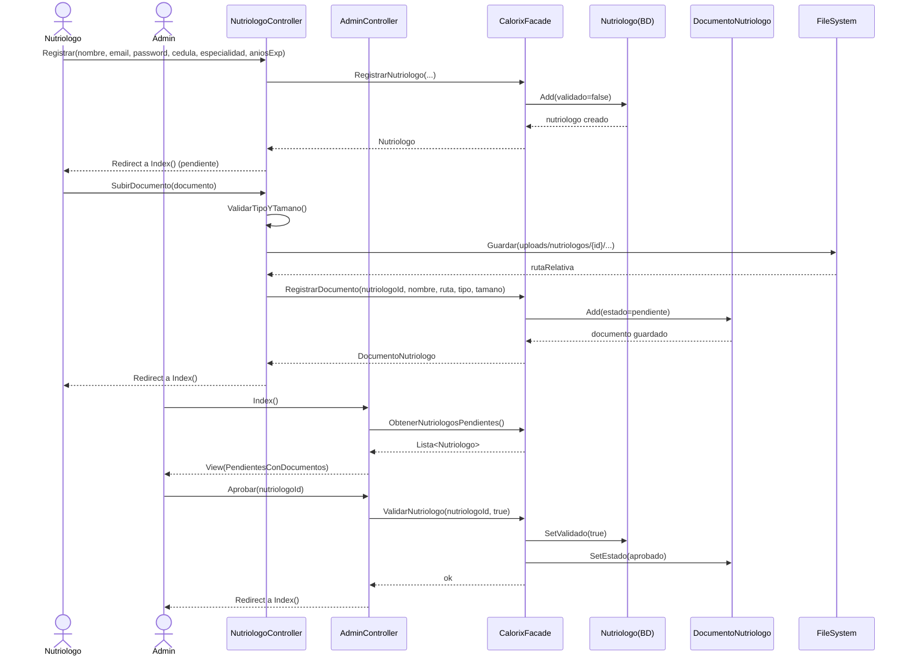
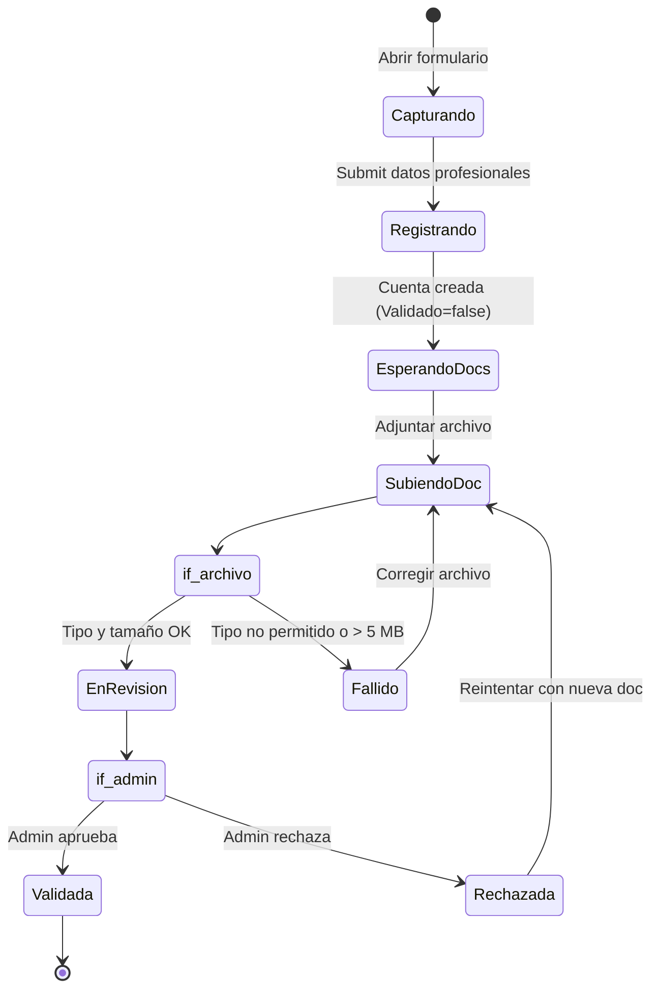
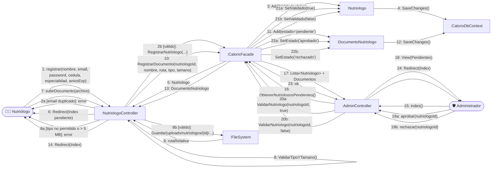

# CU8 — Gestión de Nutriólogos (Registro Profesional)

| Campo | Valor |
| --- | --- |
| **Actor principal** | Nutriólogo |
| **Actores secundarios** | Administrador (revisa y valida) |
| **Alcance** | Aplicación de nutrición (Calorix) |
| **Nivel** | Usuario (Nivel 1) |
| **Precondición** | Ninguna (registro público) |
| **Postcondición** | Cuenta de nutriólogo validada y operativa, o rechazada |

## Flujo principal

1. El profesional accede al formulario de registro para nutriólogos.
2. El nutriólogo ingresa su información profesional: cédula, especialidad y años de experiencia.
3. El nutriólogo adjunta la documentación requerida para validar su identidad.
4. El sistema envía la solicitud al administrador para revisión.
5. El administrador aprueba o rechaza la cuenta.

## Diagrama de secuencia

## Diagrama de estados

## Diagrama de colaboración

