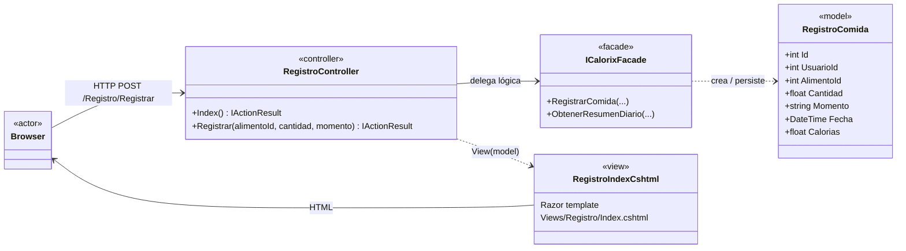
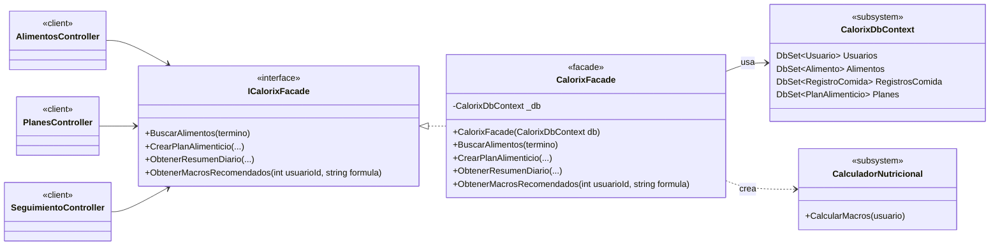
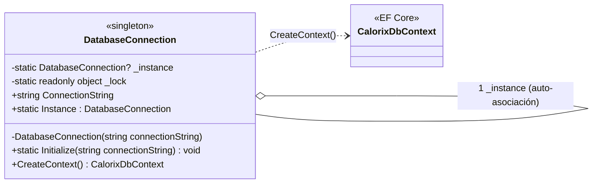
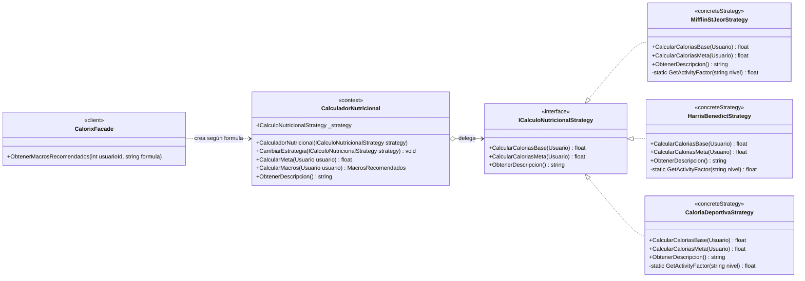

# Diagrama de Clases General — Calorix

Vista general de la arquitectura de Calorix mostrando los patrones de diseño implementados:

- **MVC** — separación Controller / Model / View (ASP.NET Core MVC).
- **Facade** — `ICalorixFacade` / `CalorixFacade` como punto único de entrada a la lógica de negocio.
- **Singleton** — `DatabaseConnection` con instancia única y acceso thread-safe.
- **Strategy** — `ICalculoNutricionalStrategy` con tres fórmulas intercambiables para el cálculo de meta calórica.

> Por legibilidad, se muestran solo los métodos y propiedades más representativos. Los nombres respetan el código real del proyecto.

---

## Diagrama global

```mermaid
classDiagram
    direction LR

    %% ===================== MVC: CONTROLLERS =====================
    class HomeController {
        +Index() IActionResult
        +Login() IActionResult
        +Login(email, password) IActionResult
        +Logout() IActionResult
    }
    class CuentaController {
        +Index() IActionResult
        +Registrar(...) IActionResult
    }
    class AlimentosController {
        +Index(q) IActionResult
        +CrearReceta(...) IActionResult
    }
    class RegistroController {
        +Index(string q) IActionResult
        +Registrar(int alimentoId, bool esReceta, float cantidad, string momento) IActionResult
        +Eliminar(int registroId) IActionResult
    }
    class SeguimientoController {
        +Index(formula, periodo) IActionResult
        +SemanaDetalle(weekOffset, formula) IActionResult
        +ResponderSolicitud(solicitudId, aprobar) IActionResult
        +DesvincularNutriologo() IActionResult
    }
    class PerfilController {
        +Index() IActionResult
        +Actualizar(...) IActionResult
    }
    class MisPlanesController {
        +Index() IActionResult
        +MarcarLeidas() IActionResult
    }
    class NutriologoController {
        +Index() IActionResult
        +Registrar(...) IActionResult
        +SubirDocumento(...) IActionResult
    }
    class PacientesController {
        +Index(q, pacienteId, ...) IActionResult
        +Vincular(usuarioId) IActionResult
        +Desvincular(pacienteId) IActionResult
        +EscribirObservacion(...) IActionResult
    }
    class PlanesController {
        +Index(int pacienteId) IActionResult
        +Crear(string nombre, string comidasJson, string pacienteIdsJson) IActionResult
        +Editar(int planId, string nombre, string comidasJson) IActionResult
        +Eliminar(int planId) IActionResult
        +Detalle(int planId) IActionResult
        +CrearRecetaClinica(string nombre, string descripcion, string ingredientesJson) IActionResult
    }
    class AdminController {
        +Index() IActionResult
        +Aprobar(int nutriologoId) IActionResult
        +Rechazar(int nutriologoId) IActionResult
        +Documento(int id) IActionResult
    }

    %% ===================== FACADE =====================
    class ICalorixFacade {
        <<interface>>
        +BuscarAlimentos(termino) List~Alimento~
        +ObtenerTodosAlimentos() List~Alimento~
        +CrearReceta(usuarioId, nombre, descripcion, ingredientes) Receta
        +CrearRecetaClinica(nutriologoId, nombre, descripcion, ingredientes) Receta
        +RegistrarComida(usuarioId, alimentoId, cantidad, momento) RegistroComida
        +RegistrarRecetaComida(usuarioId, recetaId, porciones, momento) RegistroComida
        +EliminarRegistro(registroId) bool
        +ObtenerResumenDiario(usuarioId, fecha) ResumenDiario
        +ObtenerEstadisticasSemana(usuarioId, weekOffset) EstadisticasSemana
        +ObtenerResumenPacienteRango(nutriologoId, pacienteId, desde, hasta) ResumenRango
        +ObtenerMacrosRecomendados(int usuarioId, string formula) MacrosRecomendados
        +BuscarUsuarios(termino) List~Usuario~
        +EnviarSolicitudVinculacion(nutriologoId, usuarioId) bool
        +ResponderSolicitud(usuarioId, solicitudId, aprobar) bool
        +ObtenerPacientes(nutriologoId) List~Usuario~
        +ObtenerObservacionesNutriologo(nutriologoId, pacienteId) List~Observacion~
        +EscribirObservacion(nutriologoId, pacienteId, planId, texto) Observacion
        +CrearPlanesAlimenticios(nutriologoId, pacienteIds, nombre, comidas) List~PlanAlimenticio~
        +ObtenerPlanesPaciente(usuarioId) List~PlanAlimenticio~
        +MarcarObservacionesLeidas(usuarioId) bool
        +ObtenerPerfil(usuarioId) Usuario
        +ActualizarPerfil(usuarioId, peso, altura, edad, actividad) bool
        +Login(email, password) (rol, id)
        +RegistrarUsuario(...) Usuario
        +RegistrarNutriologo(...) Nutriologo
        +RegistrarDocumento(nutriologoId, nombre, ruta, tipo, tamano) DocumentoNutriologo
        +ObtenerNutriologosPendientes() List~Nutriologo~
        +ValidarNutriologo(nutriologoId, aprobado) bool
    }
    class CalorixFacade {
        -CalorixDbContext _db
        +CalorixFacade(CalorixDbContext db)
        +BuscarAlimentos(termino)
        +ObtenerTodosAlimentos()
        +CrearReceta(...)
        +CrearRecetaClinica(...)
        +RegistrarComida(...)
        +RegistrarRecetaComida(...)
        +EliminarRegistro(...)
        +ObtenerResumenDiario(...)
        +ObtenerEstadisticasSemana(...)
        +ObtenerResumenPacienteRango(...)
        +ObtenerMacrosRecomendados(int usuarioId, string formula)
        +BuscarUsuarios(...)
        +EnviarSolicitudVinculacion(...)
        +ResponderSolicitud(...)
        +ObtenerPacientes(...)
        +ObtenerObservacionesNutriologo(...)
        +EscribirObservacion(...)
        +CrearPlanesAlimenticios(...)
        +ObtenerPlanesPaciente(...)
        +MarcarObservacionesLeidas(...)
        +ObtenerPerfil(...)
        +ActualizarPerfil(...)
        +Login(...)
        +RegistrarUsuario(...)
        +RegistrarNutriologo(...)
        +RegistrarDocumento(...)
        +ObtenerNutriologosPendientes()
        +ValidarNutriologo(...)
    }
    ICalorixFacade <|.. CalorixFacade : implements

    %% ===================== SINGLETON =====================
    class DatabaseConnection {
        <<singleton>>
        -static DatabaseConnection _instance
        -static readonly object _lock
        +string ConnectionString
        -DatabaseConnection(connectionString)
        +static Initialize(connectionString)
        +static Instance : DatabaseConnection
        +CreateContext() CalorixDbContext
    }

    %% ===================== STRATEGY =====================
    class ICalculoNutricionalStrategy {
        <<interface>>
        +CalcularCaloriasBase(Usuario) float
        +CalcularCaloriasMeta(Usuario) float
        +ObtenerDescripcion() string
    }
    class MifflinStJeorStrategy {
        +CalcularCaloriasBase(Usuario) float
        +CalcularCaloriasMeta(Usuario) float
        +ObtenerDescripcion() string
    }
    class HarrisBenedictStrategy {
        +CalcularCaloriasBase(Usuario) float
        +CalcularCaloriasMeta(Usuario) float
        +ObtenerDescripcion() string
    }
    class CaloriaDeportivaStrategy {
        +CalcularCaloriasBase(Usuario) float
        +CalcularCaloriasMeta(Usuario) float
        +ObtenerDescripcion() string
    }
    class CalculadorNutricional {
        -ICalculoNutricionalStrategy _strategy
        +CalculadorNutricional(strategy)
        +CambiarEstrategia(strategy)
        +CalcularMeta(usuario) float
        +CalcularMacros(usuario) MacrosRecomendados
        +ObtenerDescripcion() string
    }
    ICalculoNutricionalStrategy <|.. MifflinStJeorStrategy
    ICalculoNutricionalStrategy <|.. HarrisBenedictStrategy
    ICalculoNutricionalStrategy <|.. CaloriaDeportivaStrategy
    CalculadorNutricional o--> ICalculoNutricionalStrategy : usa

    %% ===================== DATA / EF CORE =====================
    class CalorixDbContext {
        +DbSet~Alimento~ Alimentos
        +DbSet~Usuario~ Usuarios
        +DbSet~Nutriologo~ Nutriologos
        +DbSet~RegistroComida~ RegistrosComida
        +DbSet~Receta~ Recetas
        +DbSet~PlanAlimenticio~ Planes
        +DbSet~RegistroPeso~ RegistrosPeso
        +DbSet~Observacion~ Observaciones
        +DbSet~SolicitudVinculacion~ Solicitudes
        +DbSet~DocumentoNutriologo~ DocumentosNutriologo
    }

    %% ===================== MODELOS =====================
    class Usuario {
        +int Id
        +string Nombre
        +string Email
        +string Password
        +int Edad
        +float Peso
        +float Altura
        +string Genero
        +string NivelActividad
        +float MetaCalorica
    }
    class Nutriologo {
        +int Id
        +string Nombre
        +string Email
        +string Cedula
        +string Especialidad
        +int AniosExp
        +bool Validado
        +bool EsAdmin
        +List~int~ PacienteIds
    }
    class Alimento {
        +int Id
        +string Nombre
        +float Calorias
        +float Proteinas
        +float Carbohidratos
        +float Grasas
        +string Categoria
    }
    class Receta {
        +int Id
        +string Nombre
        +string Descripcion
        +List~IngredienteReceta~ Ingredientes
        +float CaloriasTotal
        +int? CreadaPorNutriologoId
    }
    class IngredienteReceta {
        +int Id
        +int RecetaId
        +int AlimentoId
        +float Cantidad
    }
    class RegistroComida {
        +int Id
        +int UsuarioId
        +int AlimentoId
        +float Cantidad
        +string Momento
        +DateTime Fecha
        +float Calorias
        +float Proteinas
        +float Carbohidratos
        +float Grasas
    }
    class PlanAlimenticio {
        +int Id
        +string Nombre
        +int NutriologoId
        +int PacienteId
        +List~ComidaPlan~ Comidas
        +bool Activo
    }
    class ComidaPlan {
        +int Id
        +int PlanAlimenticioId
        +string Momento
        +string Descripcion
        +float Calorias
    }
    class RegistroPeso {
        +int Id
        +int UsuarioId
        +float Peso
        +DateTime Fecha
    }
    class Observacion {
        +int Id
        +int NutriologoId
        +int UsuarioId
        +string Texto
        +bool Leida
    }
    class SolicitudVinculacion {
        +int Id
        +int NutriologoId
        +int UsuarioId
        +string Estado
    }
    class DocumentoNutriologo {
        +int Id
        +int NutriologoId
        +string RutaRelativa
        +string Estado
    }
    class MacrosRecomendados {
        +float Calorias
        +float Proteinas
        +float Carbohidratos
        +float Grasas
    }

    %% ===================== RELACIONES MVC =====================
    HomeController --> ICalorixFacade
    CuentaController --> ICalorixFacade
    AlimentosController --> ICalorixFacade
    RegistroController --> ICalorixFacade
    SeguimientoController --> ICalorixFacade
    PerfilController --> ICalorixFacade
    MisPlanesController --> ICalorixFacade
    NutriologoController --> ICalorixFacade
    PacientesController --> ICalorixFacade
    PlanesController --> ICalorixFacade
    AdminController --> ICalorixFacade

    %% ===================== FACADE -> DATA / STRATEGY =====================
    CalorixFacade --> CalorixDbContext : usa
    CalorixFacade ..> CalculadorNutricional : crea
    CalculadorNutricional ..> MacrosRecomendados : produce

    %% ===================== SINGLETON -> CONTEXT =====================
    DatabaseConnection ..> CalorixDbContext : crea (CreateContext)

    %% ===================== DBCONTEXT -> ENTIDADES =====================
    CalorixDbContext --> Usuario
    CalorixDbContext --> Nutriologo
    CalorixDbContext --> Alimento
    CalorixDbContext --> Receta
    CalorixDbContext --> RegistroComida
    CalorixDbContext --> PlanAlimenticio
    CalorixDbContext --> RegistroPeso
    CalorixDbContext --> Observacion
    CalorixDbContext --> SolicitudVinculacion
    CalorixDbContext --> DocumentoNutriologo

    %% ===================== RELACIONES DE DOMINIO =====================
    Receta "1" *-- "*" IngredienteReceta : contiene
    IngredienteReceta --> Alimento : referencia
    PlanAlimenticio "1" *-- "*" ComidaPlan : contiene
    PlanAlimenticio --> Nutriologo : creado por
    PlanAlimenticio --> Usuario : asignado a
    RegistroComida --> Usuario
    RegistroComida --> Alimento
    RegistroPeso --> Usuario
    Observacion --> Usuario
    Observacion --> Nutriologo
    SolicitudVinculacion --> Usuario
    SolicitudVinculacion --> Nutriologo
    DocumentoNutriologo --> Nutriologo
```

---

## Vistas detalladas por patrón

Cada patrón aparece a continuación aislado para que sus participantes y roles GoF se vean con claridad.

### 1. MVC — flujo Browser → Controller → Facade → Model + View

- **Controller** (`*Controller`) — recibe la petición HTTP, valida, delega.
- **View** (`Views/**/*.cshtml`) — plantilla Razor que renderiza el HTML final.
- **Model** (`Models/Models.cs`) — entidades persistidas vía EF Core.
- Ningún controlador habla directamente con `CalorixDbContext`: pasa siempre por `ICalorixFacade`.

---

### 2. Facade — un único punto de entrada a la lógica de negocio

- Los controladores son **clientes** que sólo conocen `ICalorixFacade`.
- `CalorixFacade` oculta la complejidad del subsistema (EF Core + Strategy + reglas de negocio).
- Cambiar el ORM o reorganizar las consultas no afecta a los controladores: la fachada absorbe el impacto.

---

### 3. Singleton — `DatabaseConnection` thread-safe

- Constructor **privado** → ningún cliente puede instanciar `DatabaseConnection` con `new`.
- Campo `_instance` estático + `_lock` → instancia única con **double-check locking** (thread-safe).
- `Instance` es una **propiedad estática** get-only (no método): `DatabaseConnection.Instance.CreateContext()`.
- `Initialize(connectionString)` se llama una sola vez al arrancar la app (`Program.cs`).

---

### 4. Strategy — fórmulas de cálculo nutricional intercambiables

- **Strategy** (`ICalculoNutricionalStrategy`) — define el contrato común para calcular calorías base y meta.
- **ConcreteStrategy** — tres fórmulas:
  - `MifflinStJeorStrategy` (recomendada, moderna),
  - `HarrisBenedictStrategy` (clásica, 1919),
  - `CaloriaDeportivaStrategy` (Katch-McArdle, ideal para atletas).
- **Context** (`CalculadorNutricional`) — mantiene la estrategia activa y delega los cálculos. Permite cambiarla en caliente con `CambiarEstrategia()`.
- **Cliente** — `CalorixFacade.ObtenerMacrosRecomendados(usuarioId, formula)` recibe el nombre de la fórmula desde la URL (`?formula=mifflin`) e instancia la `ConcreteStrategy` correspondiente.

---

## Mapeo GoF → Calorix

| Patrón | Rol GoF | Clase / archivo en Calorix |
| --- | --- | --- |
| **MVC** | Controller | `*Controller` — `Controllers/*.cs` |
| **MVC** | View | Plantillas Razor — `Views/**/*.cshtml` |
| **MVC** | Model | `Usuario`, `Alimento`, `Receta`, `PlanAlimenticio`, … — `Models/Models.cs` |
| **Facade** | Facade | `CalorixFacade` — `Patterns/Facade/CalorixFacade.cs` |
| **Facade** | Interface | `ICalorixFacade` — mismo archivo (`Patterns/Facade/CalorixFacade.cs`) |
| **Facade** | Subsystem | `CalorixDbContext` (EF Core) — `Data/CalorixDbContext.cs` |
| **Facade** | Cliente | Cualquier `*Controller` |
| **Singleton** | Singleton | `DatabaseConnection` — `Patterns/Singleton/DatabaseConnection.cs` |
| **Strategy** | Strategy | `ICalculoNutricionalStrategy` — `Patterns/Strategy/CalculoNutricionalStrategy.cs` |
| **Strategy** | ConcreteStrategy | `MifflinStJeorStrategy`, `HarrisBenedictStrategy`, `CaloriaDeportivaStrategy` — mismo archivo |
| **Strategy** | Context | `CalculadorNutricional` — mismo archivo |
| **Strategy** | Cliente | `CalorixFacade.ObtenerMacrosRecomendados(int, string)` |
