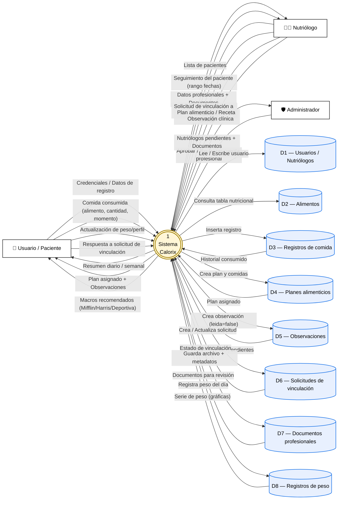

# Diagrama de Flujo de Datos (DFD) — Calorix

| Campo | Valor |
| --- | --- |
| **Tipo** | Diagrama de Flujo de Datos — Nivel 0 (contexto) |
| **Notación** | DeMarco / Yourdon |
| **Sistema** | Calorix (aplicación de nutrición ASP.NET Core MVC) |
| **Renderizado** | Mermaid (flowchart) |

## Resumen

Este DFD muestra el sistema **Calorix** como un único proceso central rodeado por sus **entidades externas** (los actores que interactúan con él) y sus **almacenes de datos** (las tablas persistentes de SQLite). Cada flecha está etiquetada con el flujo de datos concreto que viaja entre el actor/almacén y el sistema.

- **Entidades externas (rectángulos):** Usuario / Paciente, Nutriólogo, Administrador.
- **Proceso (círculo):** `1 — Sistema Calorix`.
- **Almacenes de datos (cilindros):** Usuarios, Alimentos, Registros de comida, Planes, Observaciones, Solicitudes, Documentos profesionales, Registros de peso.

## DFD Nivel 0

## Descripción de los flujos de datos

| Flujo | Origen | Destino | Datos transportados |
| --- | --- | --- | --- |
| Credenciales / Registro | Usuario | Sistema | Email, contraseña, datos antropométricos |
| Comida consumida | Usuario | Sistema | `alimentoId`, `cantidad`, `unidad`, `momento` |
| Resumen diario | Sistema | Usuario | Total kcal, macros, % cumplimiento vs meta |
| Plan asignado | Sistema | Usuario | `PlanAlimenticio` + `ComidaPlan[]` |
| Datos profesionales | Nutriólogo | Sistema | Cédula, especialidad, años de experiencia |
| Documento profesional | Nutriólogo | Sistema | Archivo PDF/JPG/PNG (max 5 MB) |
| Solicitud de vinculación | Nutriólogo | Sistema | `nutriologoId`, `usuarioId`, fecha |
| Seguimiento del paciente | Sistema | Nutriólogo | `ResumenRango`: kcal/día, peso/día, observaciones |
| Aprobación / Rechazo | Administrador | Sistema | `nutriologoId`, decisión |
| Nutriólogos pendientes | Sistema | Administrador | Lista con documentos para descarga |

## Convenciones de notación

- **Rectángulo** → Entidad externa (actor fuera del sistema).
- **Círculo / Burbuja** → Proceso (transformación que el sistema realiza).
- **Cilindro / Líneas paralelas** → Almacén de datos persistente.
- **Flecha etiquetada** → Flujo de datos con la información concreta que viaja.

> **Nota:** En este nivel 0 (contexto) el sistema completo se modela como un único proceso. Para descomponer en subprocesos numerados (registro de comidas, gestión de planes, validación profesional, etc.) se requeriría un DFD Nivel 1, fuera del alcance actual.
