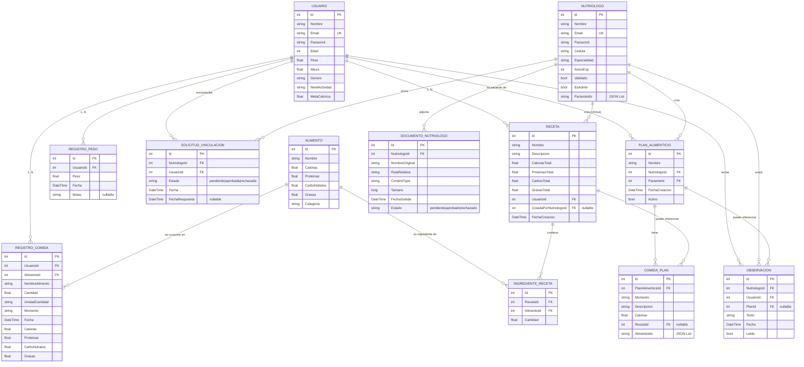

# Modelo Lógico de la Base de Datos — Calorix

| Campo | Valor |
| --- | --- |
| **Motor** | SQLite (archivo `calorix.db`) |
| **ORM** | Entity Framework Core (`Microsoft.EntityFrameworkCore.Sqlite`) |
| **Contexto** | `Calorix.Data.CalorixDbContext` |
| **Migraciones** | `Migrations/` (InitialCreate + AddPesoYObservaciones) |
| **Fuente de verdad** | `Models/Models.cs` y `Data/CalorixDbContext.cs` |

## Diagrama entidad-relación

## Esquema relacional (definición de tablas)

Notación: **PK** = llave primaria, **FK** = llave foránea, **UK** = restricción única, **NN** = NOT NULL.

### Tabla `Usuarios`
| Atributo | Tipo | Restricción |
| --- | --- | --- |
| Id | INTEGER | **PK**, autoincrement |
| Nombre | TEXT | NN |
| Email | TEXT | NN, **UK** |
| Password | TEXT | NN |
| Edad | INTEGER | NN |
| Peso | REAL | NN |
| Altura | REAL | NN |
| Genero | TEXT | NN (`M` / `F`) |
| NivelActividad | TEXT | NN (`Ligero` / `Moderado` / `Activo`) |
| MetaCalorica | REAL | NN — calculada con `ICalculoNutricionalStrategy` |

### Tabla `Nutriologos`
| Atributo | Tipo | Restricción |
| --- | --- | --- |
| Id | INTEGER | **PK**, autoincrement |
| Nombre | TEXT | NN |
| Email | TEXT | NN, **UK** |
| Password | TEXT | NN |
| Cedula | TEXT | NN |
| Especialidad | TEXT | NN |
| AniosExp | INTEGER | NN |
| Validado | INTEGER (bool) | NN, default `0` |
| EsAdmin | INTEGER (bool) | NN, default `0` |
| PacienteIds | TEXT (JSON) | NN, default `[]` — lista serializada de `int` |

### Tabla `Alimentos`
| Atributo | Tipo | Restricción |
| --- | --- | --- |
| Id | INTEGER | **PK**, autoincrement |
| Nombre | TEXT | NN |
| Calorias | REAL | NN (por 100 g) |
| Proteinas | REAL | NN |
| Carbohidratos | REAL | NN |
| Grasas | REAL | NN |
| Categoria | TEXT | NN |

### Tabla `RegistrosComida`
| Atributo | Tipo | Restricción |
| --- | --- | --- |
| Id | INTEGER | **PK**, autoincrement |
| UsuarioId | INTEGER | **FK** → `Usuarios(Id)`, NN |
| AlimentoId | INTEGER | **FK** → `Alimentos(Id)`, NN |
| NombreAlimento | TEXT | NN (snapshot del nombre) |
| Cantidad | REAL | NN |
| UnidadCantidad | TEXT | NN, default `"g"` |
| Momento | TEXT | NN (`Desayuno` / `Comida` / `Cena` / `Snack`) |
| Fecha | TEXT (DateTime) | NN |
| Calorias | REAL | NN — calculado |
| Proteinas | REAL | NN — calculado |
| Carbohidratos | REAL | NN — calculado |
| Grasas | REAL | NN — calculado |

### Tabla `Recetas`
| Atributo | Tipo | Restricción |
| --- | --- | --- |
| Id | INTEGER | **PK**, autoincrement |
| Nombre | TEXT | NN |
| Descripcion | TEXT | NN |
| CaloriasTotal | REAL | NN |
| ProteinasTotal | REAL | NN |
| CarbosTotal | REAL | NN |
| GrasasTotal | REAL | NN |
| UsuarioId | INTEGER | **FK** → `Usuarios(Id)`, NN |
| CreadaPorNutriologoId | INTEGER | **FK** → `Nutriologos(Id)`, nullable |
| FechaCreacion | TEXT (DateTime) | NN |

### Tabla `IngredienteReceta`
| Atributo | Tipo | Restricción |
| --- | --- | --- |
| Id | INTEGER | **PK**, autoincrement |
| RecetaId | INTEGER | **FK** → `Recetas(Id)`, **ON DELETE CASCADE**, NN |
| AlimentoId | INTEGER | **FK** → `Alimentos(Id)`, NN |
| Cantidad | REAL | NN |

### Tabla `Planes` (`PlanAlimenticio`)
| Atributo | Tipo | Restricción |
| --- | --- | --- |
| Id | INTEGER | **PK**, autoincrement |
| Nombre | TEXT | NN |
| NutriologoId | INTEGER | **FK** → `Nutriologos(Id)`, NN |
| PacienteId | INTEGER | **FK** → `Usuarios(Id)`, NN |
| FechaCreacion | TEXT (DateTime) | NN |
| Activo | INTEGER (bool) | NN, default `1` |

### Tabla `ComidaPlan`
| Atributo | Tipo | Restricción |
| --- | --- | --- |
| Id | INTEGER | **PK**, autoincrement |
| PlanAlimenticioId | INTEGER | **FK** → `Planes(Id)`, **ON DELETE CASCADE**, NN |
| Momento | TEXT | NN |
| Descripcion | TEXT | NN |
| Calorias | REAL | NN |
| RecetaId | INTEGER | **FK** → `Recetas(Id)`, nullable |
| AlimentoIds | TEXT (JSON) | NN, default `[]` |

### Tabla `RegistrosPeso`
| Atributo | Tipo | Restricción |
| --- | --- | --- |
| Id | INTEGER | **PK**, autoincrement |
| UsuarioId | INTEGER | **FK** → `Usuarios(Id)`, NN |
| Peso | REAL | NN |
| Fecha | TEXT (DateTime) | NN |
| Notas | TEXT | nullable |

**Índice compuesto:** `(UsuarioId, Fecha)`.

### Tabla `Observaciones`
| Atributo | Tipo | Restricción |
| --- | --- | --- |
| Id | INTEGER | **PK**, autoincrement |
| NutriologoId | INTEGER | **FK** → `Nutriologos(Id)`, NN |
| UsuarioId | INTEGER | **FK** → `Usuarios(Id)`, NN |
| PlanId | INTEGER | **FK** → `Planes(Id)`, nullable |
| Texto | TEXT | NN |
| Fecha | TEXT (DateTime) | NN |
| Leida | INTEGER (bool) | NN, default `0` |

**Índices:** `(UsuarioId)`, `(NutriologoId)`.

### Tabla `Solicitudes` (`SolicitudVinculacion`)
| Atributo | Tipo | Restricción |
| --- | --- | --- |
| Id | INTEGER | **PK**, autoincrement |
| NutriologoId | INTEGER | **FK** → `Nutriologos(Id)`, NN |
| UsuarioId | INTEGER | **FK** → `Usuarios(Id)`, NN |
| Estado | TEXT | NN (`pendiente` / `aprobada` / `rechazada`) |
| Fecha | TEXT (DateTime) | NN |
| FechaRespuesta | TEXT (DateTime) | nullable |

**Índices:** `(UsuarioId, Estado)`, `(NutriologoId, UsuarioId)`.

### Tabla `DocumentosNutriologo`
| Atributo | Tipo | Restricción |
| --- | --- | --- |
| Id | INTEGER | **PK**, autoincrement |
| NutriologoId | INTEGER | **FK** → `Nutriologos(Id)`, NN |
| NombreOriginal | TEXT | NN |
| RutaRelativa | TEXT | NN |
| ContentType | TEXT | NN |
| Tamano | INTEGER | NN |
| FechaSubida | TEXT (DateTime) | NN |
| Estado | TEXT | NN (`pendiente` / `aprobado` / `rechazado`) |

**Índice:** `(NutriologoId)`.

## Resumen de relaciones

| Relación | Cardinalidad | Tipo |
| --- | --- | --- |
| Usuario — RegistroComida | 1 : N | Composición lógica (sin cascade) |
| Usuario — Receta | 1 : N | Asociación |
| Usuario — RegistroPeso | 1 : N | Composición |
| Usuario — Observacion | 1 : N | Receptor |
| Nutriólogo — Usuario | N : M | Vía `Nutriologos.PacienteIds` (JSON) y `SolicitudVinculacion` |
| Nutriólogo — PlanAlimenticio | 1 : N | Asociación (creador) |
| PlanAlimenticio — Paciente (Usuario) | N : 1 | Plan dirigido a un paciente |
| PlanAlimenticio — ComidaPlan | 1 : N | **Composición** (`ON DELETE CASCADE`) |
| Receta — IngredienteReceta | 1 : N | **Composición** (`ON DELETE CASCADE`) |
| Alimento — IngredienteReceta | 1 : N | Asociación |
| Nutriólogo — DocumentoNutriologo | 1 : N | Composición |

## Notas de implementación

- **Listas serializadas:** `Nutriologos.PacienteIds` y `ComidaPlan.AlimentoIds` se almacenan como **TEXT (JSON)** vía `HasConversion` con `JsonSerializer`. No son tablas relacionales explícitas — son una desnormalización deliberada para acelerar la pertenencia paciente/nutriólogo y los componentes de cada comida.
- **Snapshot nutricional:** `RegistroComida` guarda los macros calculados al momento de registrar; si la tabla `Alimentos` cambia en el futuro, los registros históricos conservan los valores originales.
- **Borrado en cascada:** Solo se aplica en `Recetas → IngredienteReceta` y `Planes → ComidaPlan` (configurado en `OnModelCreating`). El resto de FKs son lógicas; no se eliminan dependencias automáticamente.
- **Unicidad:** `Usuarios.Email` y `Nutriologos.Email` tienen índices únicos para evitar duplicados.
